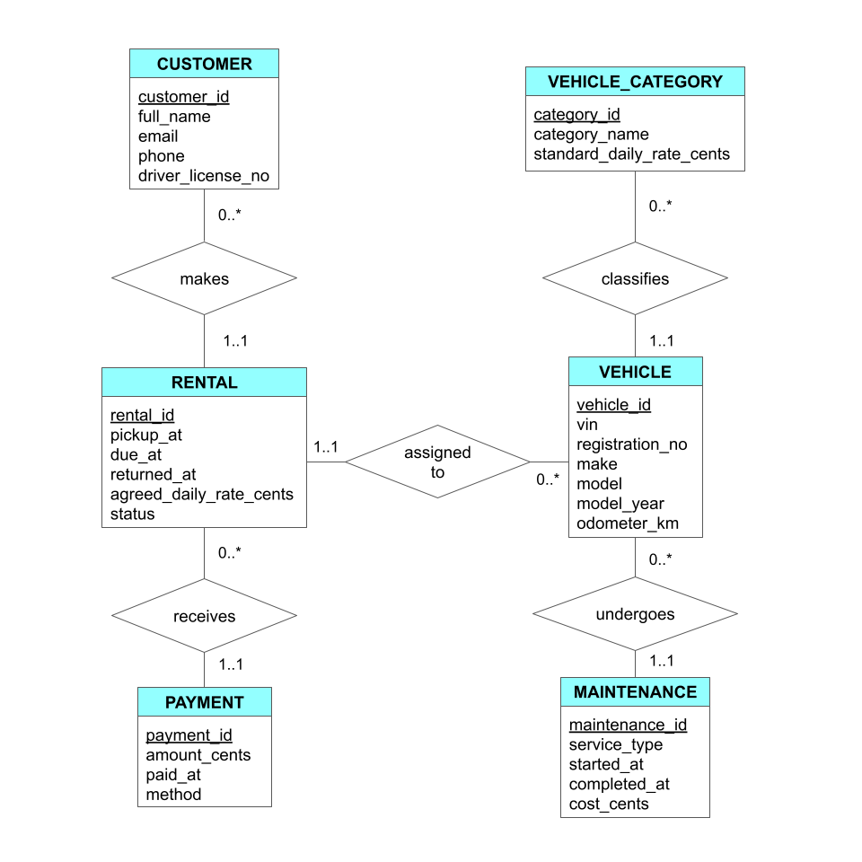

# Database Design

## Entity–Relationship Diagram

*Figure 1. Conceptual E-R model for the car-rental service.*

Rectangles represent entity sets, diamonds are relationship sets, and underlined attributes identify the primary keys. The labels beside each entity indicate the entity's minimum and maximum participation.

## Relationships

| Relationship | Business rule |
|---|---|
| Customer makes Rental | Each rental belongs to exactly one customer. A customer may have zero or many rentals. |
| Vehicle Category classifies Vehicle | Each vehicle belongs to exactly one category. A category may contain zero or many vehicles. |
| Rental assigned to Vehicle | Each rental uses exactly one vehicle. A vehicle may appear in multiple rentals over time. |
| Rental receives Payment | Each payment belongs to exactly one rental. A rental may receive zero or many payments. |
| Vehicle undergoes Maintenance | Each maintenance record belongs to exactly one vehicle. A vehicle may have zero or many maintenance records. |

## Relational Schema

The conceptual diagram represents connections through relationships. When implementing the SQL schema, we introduce these foreign keys:

| Table | Foreign key | References |
|---|---|---|
| `vehicle` | `category_id` | `vehicle_category.category_id` |
| `rental` | `customer_id` | `customer.customer_id` |
| `rental` | `vehicle_id` | `vehicle.vehicle_id` |
| `payment` | `rental_id` | `rental.rental_id` |
| `maintenance` | `vehicle_id` | `vehicle.vehicle_id` |
